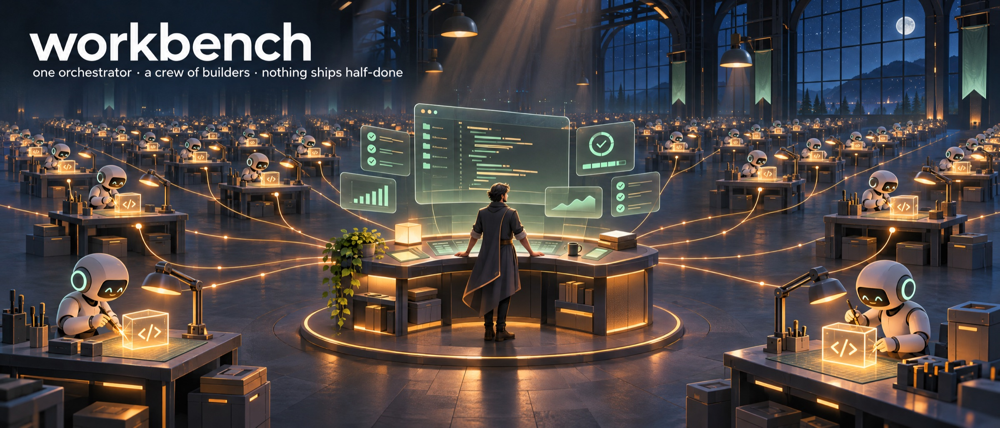
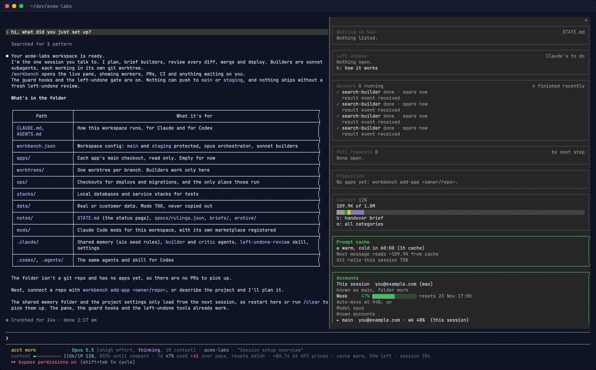
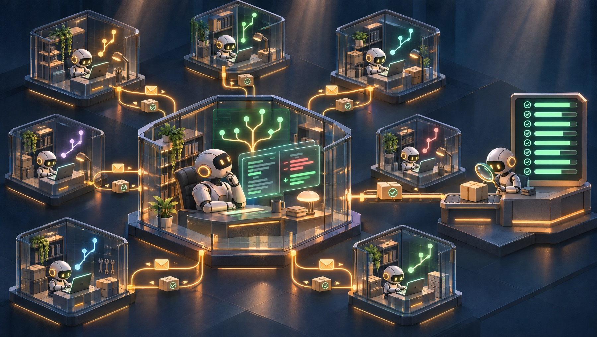
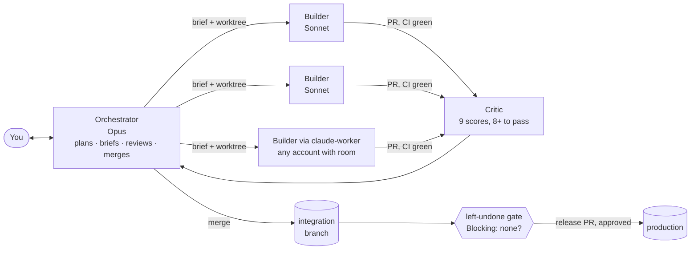
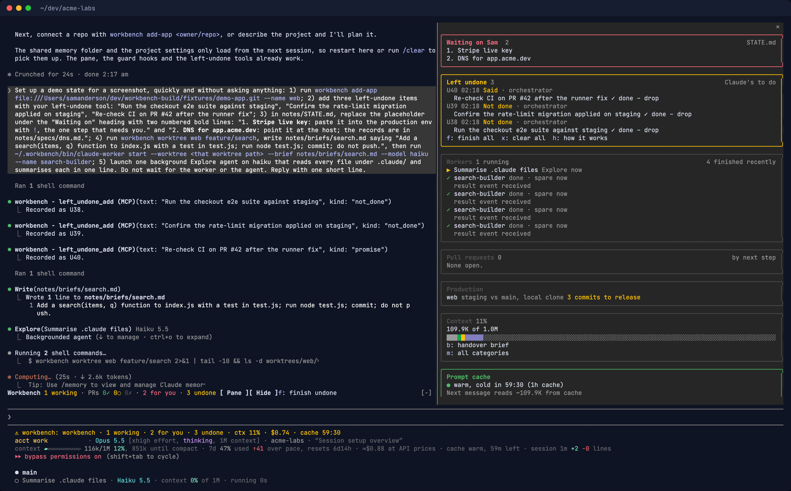
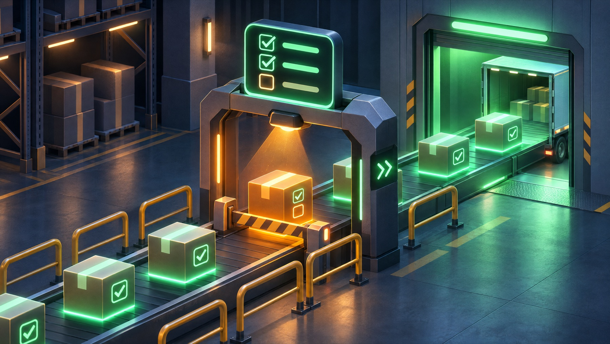

<p align="center">
  
</p>

<p align="center">
  <a href="LICENSE"></a>
  
  
  
  
</p>

# workbench

**Start Claude Code in an empty folder and it sets itself up as a workspace that runs like a small engineering team.**

You talk to one orchestrator. It plans, writes the briefs and hands work to a crew of builders, each in its own git worktree. A separate critic checks every big build. A live pane beside the chat shows what's running, what's waiting on you and what Claude promised but hasn't done yet. Guard hooks stop pushes to protected branches in every session and subagent. And nothing ships while a promised check is still open.

```bash
git clone https://github.com/jake-jiffi/workbench ~/.workbench && ~/.workbench/install.sh
```

Then make a folder and start Claude in it. That's the whole setup.

```bash
mkdir ~/dev/my-project && cd ~/dev/my-project && claude
```

---

## What happens in an empty folder

<p align="center"></p>

The moment a session starts in an empty folder, workbench builds the workspace and briefs Claude on it, before your first message. This is a real session, a few seconds after `claude`:

<p align="center"></p>

```
my-project/
├── workbench.json          the marker: apps, protected branches, ship commands, models
├── CLAUDE.md               the orchestrator's playbook
├── AGENTS.md               the same playbook for Codex
├── apps/                   one main checkout per repo (read only)
├── worktrees/<app>/<br>/   where builders work, one branch each
├── ops/                    the only place deploys and migrations run
├── stacks/                 local databases for tests
├── data/                   real data, mode 700, never in git
├── notes/STATE.md          the one status page; "Waiting on you" feeds the pane
├── mods/                   your own Claude Code mods, with a local marketplace
├── .claude/                shared memory, builder + critic agents, left-undone skill
├── .codex/                 the same agents and hooks for Codex
└── .agents/                the same skill for Codex
```

Add your repos and go:

```bash
workbench add-app acme/web-app      # clones into apps/, picks staging or main, shares the workspace memory
```

## How it works

<p align="center"></p>



- **One place to talk.** You never juggle sessions. The orchestrator runs on Opus and keeps the briefs, the reviews, the PR bodies and the merges.
- **Builders on Sonnet, in worktrees.** `workbench worktree <app> <branch>` gives each builder its own checkout, branched from the integration branch, so parallel work never collides. Builders finish locally, push once, open a PR and watch CI to green. They never merge.
- **Nobody marks their own homework.** A separate critic uses the real app, runs the tests and scores nine categories. Every score needs to be 8 or more.
- **Close out every merge.** Worktree removed, branch deleted, stacks stopped, left-undone items resolved with proof. Nothing runs that no PR needs.
- **Shared memory.** Every app in the workspace reads and writes one `.claude/memory`, seeded with six rules that keep the crew cheap and honest: one orchestrator, save tokens, push once, run unwatched until a gate, one ask that works the first time, and left undone gates shipping.

## The pane

<p align="center"></p>

The same demo a minute later, with work in flight:

<p align="center"></p>

`/workbench` docks a column of cards beside the chat, most urgent first. A border goes red only when you need to act.

| Card | What it shows |
|---|---|
| Waiting on you | The numbered items under `## Waiting on <you>` in `notes/STATE.md` |
| Left undone | What Claude promised or skipped and hasn't done yet. Not your list: its own, kept per workspace |
| Workers | Every subagent and every `claude-worker` process, with a warning when one goes quiet |
| Pull requests | Every app's PRs by next step: approved, CI red, needs review, CI running, green, draft |
| Production | How many commits each app's integration branch is ahead of production (GitHub, or the local clone for any other host) |
| Context | Tokens used by category, with `/clear`, `/compact` and a handover brief |
| Prompt cache | Warm or cold, a countdown, and how much of the next message comes from cache |
| Accounts | 5-hour and weekly meters for every account you list, with one-key moves between them |

A band above the prompt carries the same counts (`Workbench 1 working · PRs 0✓ 0◌ 0✗ · 2 for you · 3 undone`). Toasts and system notifications tell you when CI fails, a PR is approved or a worker finishes. Outside a workspace the plugin stays silent and adds nothing to your prompt.

## Guard rails

<p align="center"></p>

Three global hooks, active only inside a workspace, for every session, subagent and `claude-worker` process:

| Hook | What it does |
|---|---|
| `guard-git` | Refuses pushes to protected branches (`main` and `staging` by default), force pushes, `--all` and `--mirror` pushes, and commits in `apps/` or `ops/`. It follows `cd`, `git -C`, `--git-dir`, variables set earlier in the command, and `sh -c` strings. Quoted text such as a commit message is never mistaken for a command. |
| `guard-release` | Refuses a PR into a production branch, merging one, or a ship command (`npm`, `pnpm` or `yarn` deploy scripts, `vercel --prod`, plus your own patterns) unless `notes/left-undone-review.md` is under 3 hours old and ends `Blocking: none`. Apps with a single branch have no separate production PR to gate; their ship commands still are. |
| `session-start` | Sets up an empty folder. Inside a workspace, fetches every app, fast-forwards the main checkouts, flags a changed lockfile and lists open PRs, approved ones first. |

The **left-undone list** is the honest part. Claude calls `left_undone_add` the moment it promises something or skips a check, and `left_undone_resolve` only with proof. Before anything ships, the `left-undone-review` skill sorts every open item into done, do now, blocking, yours or later, and writes the review the hook checks. A release can't go out with a promised migration check still open.

## claude-worker: builders on any account

<p align="center"></p>

`claude-worker` runs a builder as its own Claude Code process, on whichever signed-in account has the most headroom. Workers survive the orchestrator's session ending. A worker whose account reaches 94% moves to another one between tool calls and resumes the same conversation.

```bash
claude-worker accounts                                   # meters, eligibility, free slots
claude-worker start --worktree worktrees/web/fix-login --brief notes/briefs/fix-login.md
claude-worker wait <id>                                  # run it in the background; its exit is the notification
```

Every worker gets the guard hooks, an allow-listed environment (no secrets, nothing `CLAUDE_*` or `ANTHROPIC_*` from the parent) and the workspace's `builder` agent. Accounts are config folders listed in `~/.config/workbench/config.json`; one account works fine.

## Commands

| Command | What it does |
|---|---|
| `workbench init [dir]` | Build a workspace (automatic in an empty folder). `--force` adds missing files beside existing ones and never overwrites one |
| `workbench add-app <owner/repo>` | Clone into `apps/`, pick the integration branch, point its memory at the workspace, update `CLAUDE.md` |
| `workbench worktree <app> <branch>` | A builder's worktree from `origin/<integration>`, `--no-track`, `node_modules` linked |
| `workbench done <app> <branch>` | Close out: remove the worktree and the branch, print the checklist |
| `workbench status` | What the session-start hook prints |
| `workbench doctor [--deep]` | Check the workspace and the install, PASS or FAIL per line. `--deep` runs the hook test suites |
| `workbench update` | Fast-forward the install to GitHub now. It also runs by itself once a day |
| `/workbench` | Open the pane |

## Configuration

`~/.config/workbench/config.json` is yours and never leaves your machine:

```json
{
  "owner": "Sam",
  "autoInit": true,
  "autoUpdate": true,
  "accounts": [ { "label": "main", "dir": "~/.claude" } ],
  "protectedBranches": ["main", "staging"],
  "models": { "orchestrator": "opus", "builder": "sonnet" }
}
```

Each workspace's `workbench.json` holds its apps, protected branches, ship patterns and models. Turn auto-setup off with `"autoInit": false`, or for one session with `WORKBENCH_AUTO=0 claude`. Turn auto-update off with `"autoUpdate": false`, or `WORKBENCH_AUTOUPDATE=0`.

Auto-setup only touches a folder that is completely empty (a `.DS_Store` is fine). It never touches your home folder, `/`, temp folders, hidden folders, the standard folders in your home (Desktop, Documents, Downloads and the rest), anything inside a git repo, or anything already inside a workspace.

More than one Claude config folder (several accounts)? Wire each one: `install.sh --config-dir ~/.claude-work`.

## Works with Codex

Every workspace carries `AGENTS.md`, `.codex/agents/` (builder and critic) and `.codex/hooks.json` with the same guard hooks, so Codex sessions follow the same rules and share the same memory. The pane and the left-undone tools are Claude Code features; from Codex, the list lives in `notes/STATE.md`.

## Tested

860 automated checks, all passing on macOS with the stock bash 3.2 and Node 22:

| Suite | Checks |
|---|---|
| `guard-git` hook | 173 |
| `guard-release` hook | 57 |
| `session-start` hook: auto-setup eligibility, two sessions racing for one folder, the brief, the background update | 87 |
| `install.sh`: idempotent, round-trips, never touches anything outside the folders it's given | 49 |
| `workbench` CLI, including `update` | 39 |
| End to end: empty folder to verified workspace | 73 |
| The pane (`claude plugin test`) | 268 |
| `claude-worker` | 114 |

And in real Claude Code sessions: started in an empty folder, the session set the workspace up, recorded and resolved left-undone items across sessions, added an app from a git remote, made and closed a worktree, and had a Sonnet builder subagent ship a change in its own worktree. `claude-worker` finished a job on a second account. The guards refused a push to `main`, a commit in `apps/` and a deploy without a review. An independent critic then attacked the hooks; every bypass it found is fixed and now in the suites.

Run the hook suites yourself with `workbench doctor --deep`.

## Update and uninstall

workbench keeps itself up to date. Once a day, the first session to start fast-forwards `~/.workbench` to GitHub in the background, so the session never waits for it. The new version loads in the next session, or run `/reload-plugins` in an open one. It only fast-forwards: local changes, another branch or commits of your own leave the install alone. `workbench doctor` shows the last check, and `workbench update` runs one now.

```bash
workbench update                         # update now instead of waiting for the daily check
~/.workbench/install.sh --uninstall      # removes the hooks, links and plugin; keeps your config and workspaces
rm -rf ~/.workbench ~/.config/workbench  # then, to remove everything
```

## Requirements

Claude Code, `git`, `jq`, Node 20 or later (for `claude-worker`), and bash 3.2 or later (macOS's stock bash is fine). `gh` is optional: it turns on the PR cards and the merge checks in the release gate.

## Credits

The pane's left-undone list, context card, cache timer and card layout draw on [terminal-desk](https://github.com/Doonminus2/claude-code-TerminalDesk-Plugin) by Doonminus2 (MIT). The handover brief draws on ideas from [context-watch](https://github.com/spychiatrist/context-watch) by spychiatrist (MIT). See [NOTICE](plugin/NOTICE).

## Licence

MIT. See [LICENSE](LICENSE).
